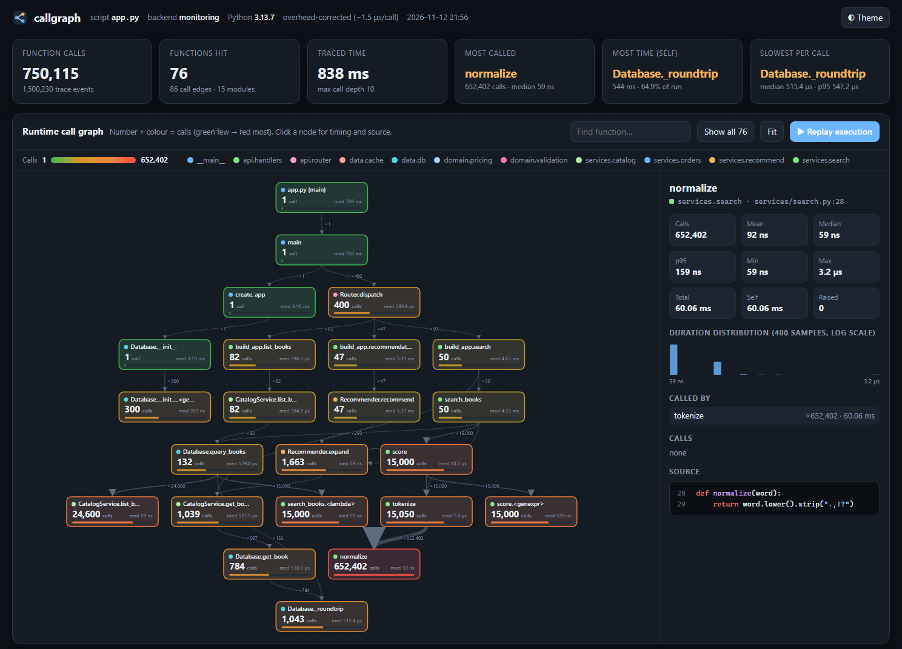
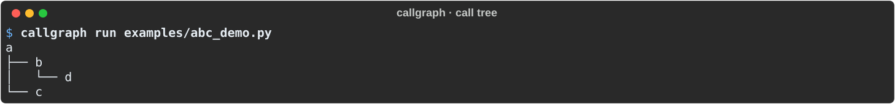
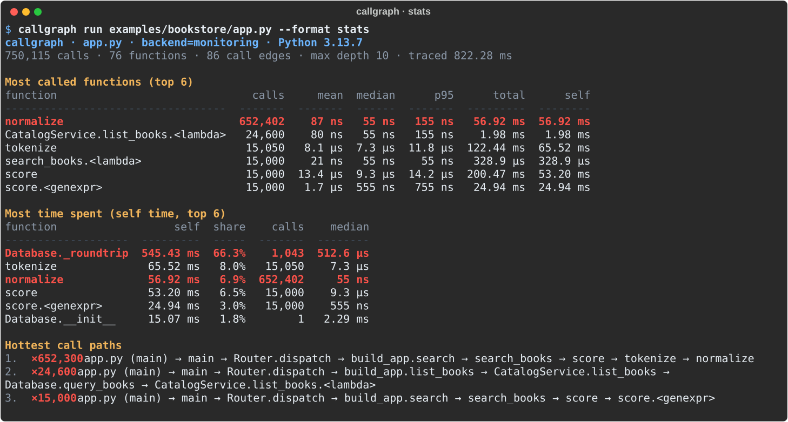
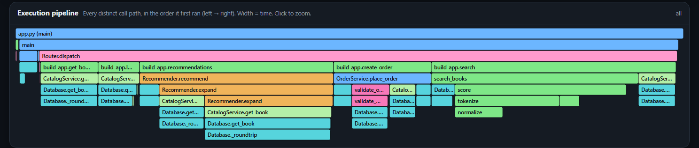
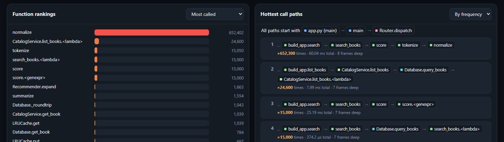

<p align="center">
  
</p>

<p align="center">
  
  
  
  
</p>

<p align="center">
  <b>Your code ran. Something was slow, or weird, or called way too often.<br>
  callgraph shows you <i>what actually happened</i>.</b>
</p>

---

**callgraph** records a real run of your Python program and shows every function that
executed: **who called whom, in what order, how many times, and how long it took.** You
don't add decorators or change any code. The output is one gorgeous, self-contained HTML
dashboard.

<picture>
  <source media="(prefers-color-scheme: light)" srcset="docs/images/dashboard-light.png">
  
</picture>

> 🔥 **Spot the red box.** Every node shows how many times it was called, coloured from
> 🟢 *rarely* to 🔴 *constantly*. Here, one tiny helper (`normalize`) accounts for
> **652,402 of 750,115 calls**. That's a missing search index, found in one glance.

---

## ✨ What you get

| | |
|---|---|
| 🌡️ **Call-count heatmap** | The big number on every node is its call count. Colour makes the hottest function jump out. |
| ▶️ **Execution replay** | Animates the run through the graph in the order it happened. |
| 🔍 **Click any function** | Calls, mean / median / p95 / max, callers, callees, a duration histogram and **its source code**. |
| 🧵 **Execution pipeline** | Every distinct call path, left to right in the order it first ran, sized by time. |
| 🏆 **Rankings & hot paths** | Most called, most time, slowest per call, and the call chains that run most. |
| 📎 **One file, works offline** | Attach it to a PR, a ticket or Slack. No server needed. |
| 🪶 **Low overhead** | Uses Python 3.12's `sys.monitoring`, and skips code you didn't ask about. |

---

## 🚀 Quickstart (about 2 minutes)

### 1. Get the code

```bash
git clone https://github.com/c-wilson04/callgraph.git
cd callgraph
```

### 2. Make a virtual environment

A virtual environment ("venv") is a private Python install for this project, so nothing
touches your system Python.

<details open>
<summary><b>🪟 Windows (PowerShell)</b></summary>

```powershell
python -m venv .venv
.venv\Scripts\Activate.ps1
```

> **"Running scripts is disabled on this system"?** Run this once, then activate again:
> `Set-ExecutionPolicy -Scope CurrentUser RemoteSigned`
>
> In Command Prompt (cmd) use `.venv\Scripts\activate.bat` instead.
</details>

<details open>
<summary><b>🍎 macOS / 🐧 Linux</b></summary>

```bash
python3 -m venv .venv
source .venv/bin/activate
```
</details>

When it worked, your prompt starts with **`(.venv)`**. Activate it again in every new
terminal window. Run `deactivate` to leave.

### 3. Install callgraph

```bash
pip install -e ".[dev]"
```

`-e` means "editable": changes you make to the source take effect immediately. `[dev]`
adds `pytest` for running the tests.

### 4. Check it works

```bash
callgraph --help
```

> **`callgraph` is not recognized?** Your venv isn't active, so redo step 2. Or call it directly:
> `.venv\Scripts\callgraph.exe` (Windows) or `.venv/bin/callgraph` (macOS/Linux).

### 5. Your first trace 🎉

```bash
callgraph run examples/bookstore/app.py --format html --open
```

That runs a small bookstore API (400 simulated requests), traces it, and opens the dashboard in your browser.

---

## 🎬 Take the guided tour

The repo comes with a demo that walks through everything step by step, pausing between steps:

```powershell
# Windows
powershell -ExecutionPolicy Bypass -File demo\run-demo.ps1
```
```bash
# macOS / Linux / Git Bash
./demo/run-demo.sh
```

Add `-NoPause` / `--no-pause` for a hands-free run (great for screen recording), and
`-Bench` / `--bench` to include the overhead benchmark. The demo creates the venv for you
if it doesn't exist yet.

---

## 🧭 Using callgraph

```
callgraph run [options] your_script.py [arguments for your script]
```

callgraph runs your script exactly like `python your_script.py`, recording as it goes.
It needs a **script that does some work**: your app's entry point, or a small script that
uses the library you want to explore (see [Try it on real projects](#-try-it-on-real-projects)).

### Pick an output

| Flag | You get |
|---|---|
| *(none)* | The call tree in your terminal. Repeated calls merge as `name ×N`. |
| `--format stats` | Tables: most called, most time, hottest paths |
| `--format html --open` | 🌟 The interactive dashboard |
| `--format metrics-json` | Every metric as JSON, for CI or your own tools |
| `--format json` / `mermaid` / `events` | Full per-call tree / Mermaid diagram / raw events |

<p align="center"></p>

<p align="center"></p>

### Tell it what to trace (the most important option)

By default callgraph traces **only the code in your script's folder**. The standard
library and installed packages are skipped, which keeps graphs readable and runs fast.

```bash
callgraph run app.py --root src/               # trace everything under src/
callgraph run app.py --exclude tests           # skip paths containing "tests" (repeatable)
callgraph run app.py --include-site-packages   # also trace installed libraries (big graphs!)
```

> 💡 **Rule of thumb:** trace the code you're asking a question about, and nothing more.

### Passing arguments to your script

callgraph's flags can go **before or after** the script. Anything it doesn't recognise is
passed to your script, and everything after `--` goes to your script untouched:

```bash
callgraph run app.py 1000 --format stats          # app.py receives: 1000
callgraph run app.py --format html -- --verbose   # app.py receives: --verbose
```

### From Python code

```python
from callgraph import trace
from callgraph.metrics import compute_metrics
from callgraph.render.html import render_html

with trace() as recorder:
    main()

with open("report.html", "w", encoding="utf-8") as f:
    f.write(render_html(compute_metrics(recorder)))
```

---

## 🗺️ Reading the dashboard

**The graph.** Each box is a function that *actually ran*. The big number is its **call
count**, and the colour scale runs 🟢 → 🟡 → 🟠 → 🔴 from few calls to many (log scale, so
1 vs 50 vs 15,000 all look different). The small dot is the function's module, and
`med` is its median time per call. Edges are real calls, labelled with counts.

**Try this:** click **▶ Replay execution**, then click the red node. Follow "Called by"
upward to see *why* it's called so much.

**The pipeline.** Every distinct call path, left to right in the order it first ran.
Width = time. Click a block to zoom in.



**Rankings & hot paths.** Switch the dropdown between *most called*, *total time*,
*self time*, *mean*, *median* and *p95*. Hot paths show the exact chains that run most.



> **Total vs self time:** *total* includes everything the function called; *self* is time
> spent in the function's own code. A high *self* time is where to optimise.

---

## 🧪 Try it on real projects

callgraph has been tested on three well-known open-source projects. Ready-made driver
scripts live in [`examples/real_world/`](examples/real_world).

```bash
mkdir ../playground && cd ../playground
git clone --depth 1 https://github.com/Textualize/rich.git
git clone --depth 1 https://github.com/psf/black.git
git clone --depth 1 https://github.com/sympy/sympy.git
pip install -e ./rich -e ./black -e ./sympy      # with your callgraph venv active
cd ../callgraph
```

| Project | Command | What you'll see |
|---|---|---|
| **rich** (terminal formatting) | `callgraph run --root ../playground/rich/rich --format html --open examples/real_world/drive_rich.py` | About 414k calls in 424 functions. The table renderer measuring every cell. |
| **black** (code formatter) | `callgraph run --root ../playground/black/src --format html --open examples/real_world/drive_black.py 5` | About 1M calls when formatting 5 files. The parser pipeline is up to 95 calls deep. |
| **sympy** (symbolic math) | `callgraph run --root ../playground/sympy/sympy --format html --open examples/real_world/drive_sympy.py` | 🏋️ The stress test: 3,000+ functions. Much of it is sympy importing itself. |

**Gotchas we hit, so you don't have to:**
- **Install from source** (`pip install -e`). black from PyPI is compiled to C, which
  callgraph can't see inside.
- **Keep your script out of the clone's parent folder.** A script next to a `sympy/`
  repo folder imports the *folder* instead of the library. That's normal Python behaviour,
  but it's confusing.
- **Start small** with call-heavy code: `drive_black.py 5` formats 5 files instead of all of them.

---

## ⏱️ "Does it slow my code down?"

Somewhat. Every tracer does, so here are the measured numbers. Overhead scales with **how
many calls** you trace, not how long they take:

| Workload (bookstore sample) | `sys.monitoring` (3.12+) | `settrace` (3.10–3.11) |
|---|---:|---:|
| Web-style API with database round-trips, tracing scoped | **1.11×** | 1.65× |
| Same API, everything traced | 2.5× | 3.3× |
| Worst case: pure CPU, a Python call every ~200 ns | 8.9× | 12.6× |

Measure your own workload:

```bash
callgraph bench your_script.py
```

**Are the timings real?** Call counts are always exact. For timings, callgraph measures
its own overhead at startup and subtracts it from every call (like cProfile's
calibration), so the numbers you see reflect your code, not the tracer.
`--no-calibrate` shows the raw values.

**Keep it fast:** use Python 3.12+, `--exclude` hot modules you've already understood,
and trace smaller inputs.

---

## ✅ Running the tests

```bash
pytest            # 25 tests, about 2 seconds
pytest -v         # see each one
```

The tests cover call counts, recursion, generators, exceptions, threads, the overhead
correction, every output format and the CLI, including running the bookstore sample.

---

## 🏗️ How it works

```
your program ─► tracing backend ─► recorder ─────────► metrics ─────► stats / html / json
                sys.monitoring      calling-context      counts, times,
                (or sys.settrace)   tree, built live     percentiles, hot paths
```

| Module | Job |
|---|---|
| `instrumentation.py` | Hooks into Python (`sys.monitoring`, with a `sys.settrace` fallback) |
| `filters.py` | Decides which files count as "your code" |
| `recorder.py` | Merges calls into a calling-context tree as they happen. Memory stays bounded. |
| `calibrate.py` | Measures and subtracts the tracer's own cost |
| `metrics.py` | Per-function stats, edges, hot paths. Recursion-safe. |
| `render/` | Terminal tree, stats tables, the HTML dashboard, JSON, Mermaid |
| `cli.py` | `callgraph run` and `callgraph bench` |

```
callgraph/
├── src/callgraph/        the package
├── tests/                pytest suite
├── examples/
│   ├── abc_demo.py       the 15-line "hello world"
│   ├── bookstore/        a layered API: router → handlers → services → domain → data
│   └── real_world/       drivers for rich, black and sympy
├── demo/                 one-click demo, 5-minute video script, Q&A cheat sheet
└── docs/images/          the pictures in this README
```

---

## 🚧 Limitations & roadmap

**Today:**
- **Python only.** The metrics and dashboard are language-agnostic. Only the tracer is
  Python-specific.
- Python-level code only: time inside C extensions is billed to the Python function that called them.
- Async code is handled correctly (a resumed coroutine isn't a new call), but the graph
  shows call stacks, not an async task graph.

**Next up:**
- 🌍 Tracers for more languages (JavaScript/TypeScript and Go first)
- 🔀 Run-to-run diffs: *"this PR added 40,000 calls to `normalize`"*
- 🧪 A pytest plugin: per-test call graphs, and "which tests run this function?"
- ⚡ A native (C/Rust) hot loop to cut worst-case overhead

Ideas, bugs, "this number looks wrong": [open an issue](https://github.com/c-wilson04/callgraph/issues). Feedback is the whole point. 🙌

---

<p align="center"><sub>MIT licensed · made for people who want to know what their code is <i>really</i> doing</sub></p>
